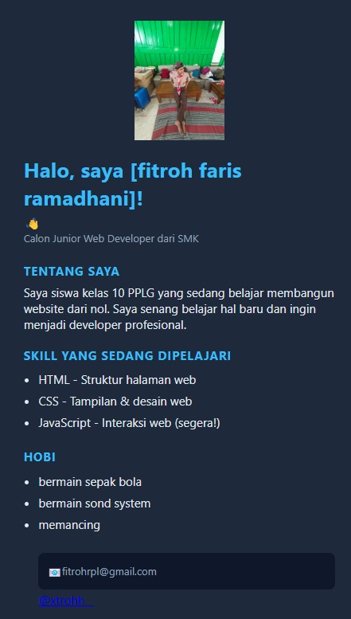

# Portofolio Fitroh Faris Ramadhani

Website portofolio pribadi yang dibuat di Kelas Industri UBIG.
Website ini tampil responsif dan rapi di ponsel, tablet, dan laptop.

## Tampilan

## Fitur
- **Beranda**: Profil, hobi, cita-cita, keahlian, dan jadwal belajar mandiri.
- **Proyek**: Kumpulan proyek portofolio dengan filter kategori (Semua, HTML, CSS, JavaScript).
- **Kontak**: Formulir kontak lengkap dengan fitur penghitung karakter pesan otomatis (maksimal 300 karakter).
- **Kalkulator**: Kalkulator nilai tugas, UTS, dan UAS untuk menghitung nilai rata-rata dan predikat kelulusan.
- **Mode Gelap (Dark Mode)**: Penggantian tema terang dan gelap dengan tombol toggle responsif.

## Teknologi
- HTML5 (Semantik & Struktur)
- CSS3 (Flexbox, CSS Custom Properties / Variables, Media Queries)
- JavaScript ES6+ (DOM Manipulation, Event Listener)
- Git & GitHub

## Kontak & Tautan
- **Email**: fitrohfaris2@gmail.com
- **GitHub**: [fitrohrpl-boop](https://github.com/fitrohrpl-boop)
- **Dibuat oleh**: Fitroh Faris Ramadhani, SMK Brantas Karangkates
